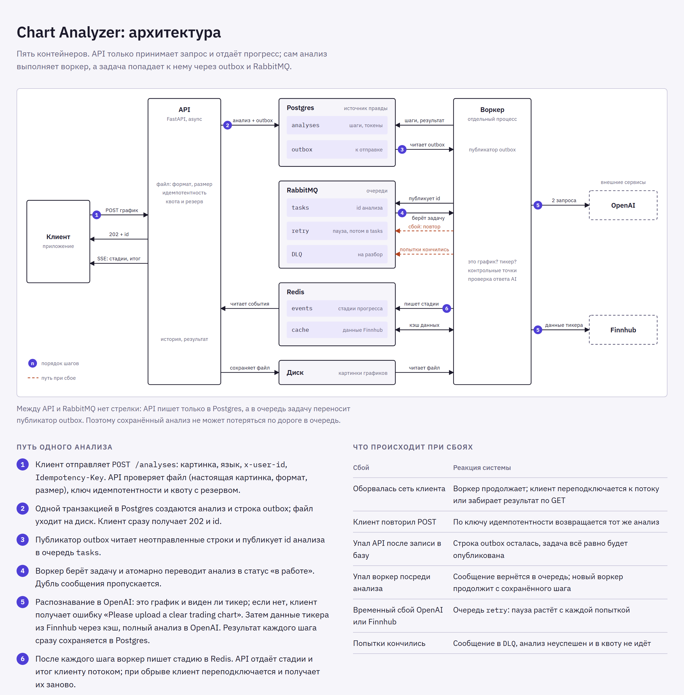

# Chart Analyzer

Backend for Finelo's AI **Chart Analyzer**: a user uploads an image of a trading chart and
receives a structured analysis in their language, enriched with the real current price,
analyst ratings and latest news for the recognized ticker. Every analysis is stored for
history, and each user has a daily budget of 500,000 AI tokens.

- [Launch](#launch)
- [Try it](#try-it)
- [Endpoints](#endpoints)
- [How it works](#how-it-works)
- [Quota](#quota)
- [Localization](#localization)
- [Tests](#tests)
- [Project layout](#project-layout)
- [Configuration](#configuration)
- [Known limits](#known-limits)

## Launch

Requirements: Docker with Compose.

```bash
cp .env.example .env      # then fill in OPENAI_API_KEY and FINNHUB_API_KEY
docker compose up --build
```

| What | Where |
|---|---|
| Demo page | http://localhost:8000 |
| Swagger UI | http://localhost:8000/docs |
| RabbitMQ management | http://localhost:15673 (`chart` / `chart`) |

`.env` needs two keys:

- `OPENAI_API_KEY` for any OpenAI-compatible endpoint. For a LiteLLM proxy also set
  `OPENAI_BASE_URL` (for example `https://litellm.example.com/v1`) and the model names
  `OPENAI_RECOGNITION_MODEL` / `OPENAI_ANALYSIS_MODEL`. The model must accept images and
  support structured outputs; the defaults are `gpt-5-mini`.
- `FINNHUB_API_KEY`: a free key from https://finnhub.io.

Compose starts five containers: `api`, `worker`, `postgres`, `rabbitmq`, `redis`, plus a
one-off `migrate` that applies the schema and the demo data before the others start.

Without the keys the service still starts, and history, quota and the demo data work.
Only new analyses fail (after their retries) with "service temporarily unavailable".

## Try it

The data migration creates three demo users. Pass one as the `x-user-id` header, or pick
it on the demo page at http://localhost:8000: a single static page (no build step) that
uploads a chart, shows the live stages, renders the result and lists the history.

| `x-user-id` | Shows |
|---|---|
| `demo-user` | History: Apple (English), Bitcoin (Spanish, no analyst review), Tesla (German) and one failed upload that was not a chart |
| `demo-user-no-quota` | 495,000 tokens spent today: a new upload is rejected with `429` |
| `demo-user-new` | Nothing yet: empty history, full quota |

The quota resets at 00:00 UTC, so `demo-user-no-quota` is over the limit only on the day
the migration ran. To re-seed: `docker compose down -v && docker compose up --build`.

Sample charts are in [`samples/`](samples).

```bash
# 1. Upload a chart. The answer is immediate: 202 with the analysis id.
curl -X POST http://localhost:8000/api/v1/analyses \
  -H "x-user-id: demo-user-new" \
  -F "image=@samples/aapl.png" -F "language=es"

# 2. Follow the progress. The last event carries the full analysis.
curl -N http://localhost:8000/api/v1/analyses/<id>/events -H "x-user-id: demo-user-new"

# 3. History and quota.
curl http://localhost:8000/api/v1/analyses -H "x-user-id: demo-user"
curl http://localhost:8000/api/v1/quota    -H "x-user-id: demo-user-no-quota"

# 4. A picture that is not a chart ends with a localized "upload a clear chart" error.
curl -X POST http://localhost:8000/api/v1/analyses \
  -H "x-user-id: demo-user-new" -F "image=@samples/not_a_chart.png" -F "language=fr"
```

## Endpoints

Every request needs the `x-user-id` header (the assignment states that authorization is
handled upstream). A user only ever sees their own analyses. Full schemas are in Swagger.

| Method and path | Purpose |
|---|---|
| `POST /api/v1/analyses` | Upload a chart. Multipart form: `image` (PNG, JPEG or WebP, up to 10 MB) and `language` (`en` by default). Optional `Idempotency-Key` header. Returns `202` with the analysis in status `queued`; a replay of the same key returns `200` with the original analysis. |
| `GET /api/v1/analyses/{id}/events` | Live progress as Server-Sent Events: `stage` events (`recognizing`, `market_data`, `analyzing`), then one `completed` or `failed` event with the full analysis. Supports `Last-Event-ID` for reconnects. |
| `GET /api/v1/analyses/{id}` | One analysis: status, result or error. |
| `GET /api/v1/analyses?limit=20&offset=0` | History, newest first. |
| `GET /api/v1/analyses/{id}/image` | The uploaded chart. |
| `GET /api/v1/quota` | Tokens used and reserved today, what is left, and the reset time. |
| `GET /health` | Liveness probe. |

### The analysis object

```jsonc
{
  "id": "4f8f8b4a-d8c1-49ea-b7a5-b20ddb08a84a",
  "status": "completed",             // queued | processing | completed | failed
  "stage": "done",                   // queued | recognizing | market_data | analyzing | done
  "language": "es",
  "asset": { "symbol": "AAPL", "name": "Apple Inc", "type": "stock" },
  "tokens_used": 7466,
  "error": null,                     // { "code", "message" } when failed
  "result": {
    "asset": { "symbol": "AAPL", "name": "Apple Inc", "type": "stock", "logo_url": "https://..." },
    "summary": "El gráfico muestra un tramo alcista sostenido...",
    "current_price": { "price": 340.97, "currency": "USD", "change": 4.33, "change_percent": 1.2862, "as_of": "2026-10-12T20:00:00Z" },
    "analyst_review": {              // null when nobody covers the asset, e.g. crypto
      "period": "2026-09-01", "total_analysts": 53, "consensus": "buy",
      "strong_buy": { "count": 12, "percent": 22.6 }, "buy": { "count": 22, "percent": 41.5 },
      "hold": { "count": 15, "percent": 28.3 }, "sell": { "count": 3, "percent": 5.7 },
      "strong_sell": { "count": 1, "percent": 1.9 }
    },
    "key_insights": {
      "trend": { "value": "bullish", "explanation": "..." },             // bullish | bearish | sideways | neutral
      "volatility": { "value": "medium", "explanation": "..." },         // high | medium | low
      "market_sentiment": { "value": "bullish", "explanation": "..." }   // bullish | bearish | neutral
    },
    "trading_signals": {
      "position": "long",            // long | short
      "start_level": 340.97, "safety_stop": 325.0,
      "projected_exit_1": 380.0, "projected_exit_2": 400.0,
      "support_level": 328.62, "resistance_level": 380.09,
      "rationale": "..."
    },
    "latest_news": [
      { "headline": "La acción de Apple se acerca a máximos históricos...",
        "original_headline": "Apple Stock Nears Record High...",
        "sentiment": "positive",     // positive | negative | neutral
        "source": "Yahoo", "url": "https://...", "published_at": "2026-10-12T19:32:55Z" }
    ]
  },
  "image_url": "/api/v1/analyses/4f8f8b4a-.../image",
  "events_url": "/api/v1/analyses/4f8f8b4a-.../events"
}
```

The blocks map to the design: Current Price → `current_price`, Analyst Review →
`analyst_review`, Key Insights → `key_insights`, Trading Signals by AI →
`trading_signals`, Latest News → `latest_news`. The first three market blocks are real
data from Finnhub; insights and signals come from the AI's reading of the image.

### Errors

Every error has one shape, with the message in the user's language:

```json
{ "error": { "code": "quota_exceeded", "message": "Has alcanzado tu límite diario de análisis. Se restablece a medianoche UTC." } }
```

| HTTP | `code` | When |
|---|---|---|
| 401 | `missing_user_id` | No `x-user-id` header |
| 413 | `image_too_large` | File over the size limit |
| 422 | `invalid_image`, `unsupported_language`, `validation_error` | Not a PNG/JPEG/WebP image, unknown language, malformed request |
| 429 | `quota_exceeded` | Daily token quota spent (`Retry-After` gives the seconds until reset) |
| 429 | `too_many_active_analyses` | More than 3 analyses of one user in progress |
| 404 | `analysis_not_found` | Unknown id, or another user's analysis |
| 404 | `not_found` | Unknown path |

An analysis that fails while it is being processed is not an HTTP error: its `status`
becomes `failed` and `error` says why (`unclear_chart`, `asset_not_found`,
`market_data_unavailable`, `ai_unavailable`, `invalid_ai_response`). The same object
arrives as the final `failed` event of the stream.

## How it works



An analysis takes 8–20 seconds, almost all of it waiting for the AI model, so it does not
run inside the HTTP request.

1. **API** validates the file (real image, format, size), checks the quota, stores the
   image and, in one database transaction, inserts the analysis and an **outbox** row.
   It answers `202` at once.
2. The **outbox relay** publishes unsent rows to RabbitMQ. Because the analysis and its
   task commit together, a stored analysis can never be left without a task.
3. A **worker** claims the analysis and runs the pipeline:
   **recognize** (cheap AI call: is it a chart, which ticker?) → **market data**
   (Finnhub: price, analyst ratings, news, fetched concurrently and cached in Redis) →
   **analyze** (AI call with the image and the market data, answering in the user's
   language) → **validate** → save.
4. Each stage is written to a Redis Stream; the API relays it to the client over SSE.

What makes this hold up under failures:

| Situation | What happens |
|---|---|
| Client loses the connection | The worker carries on. The client reconnects to the stream (events are replayed) or fetches the result. |
| Client retries the upload | With an `Idempotency-Key` it gets the original analysis back, not a second one. |
| Same task delivered twice | The worker claims an analysis with one atomic `UPDATE`; a duplicate of a finished analysis is dropped. |
| Worker dies mid-analysis | The task is redelivered. Each step saved its result as a checkpoint, so the retry resumes instead of paying for the same AI call again. |
| A slow worker and a second worker overlap | One attempt is cut off before its lease expires, and finishing an analysis requires the claim number, so a late worker cannot overwrite the result. |
| Database fails around the pipeline | The task is retried like any transient failure. If its outcome still could not be recorded, a periodic sweep fails analyses that stayed active and untouched for 30 minutes, releasing their quota reservation. |
| AI or Finnhub fails temporarily | The task goes through delay queues (5 s, 30 s, 120 s) and is retried. |
| Retries run out | The task lands in the dead-letter queue, the analysis is marked failed, and it does not count against the quota. |
| Image is not a chart, or the ticker is unreadable | Permanent failure after the cheap first call; the expensive call is never made. |

The AI is treated as an untrusted source. Its answer must match a strict JSON schema, and
the price levels must be consistent with the position it chose (for a long:
stop < entry < target 1 ≤ target 2); news facts always come from the provider, and the
model may only pick from the offered articles. A rejected answer is retried.

The reasoning behind each decision, the data model and the RabbitMQ topology are in
[docs/DESIGN.md](docs/DESIGN.md).

## Quota

Each user may spend up to **500,000 tokens per UTC day** on successful analyses.

The cost of an analysis is known only after the AI answers, so "does this request fit?"
cannot be checked up front. Instead, every analysis in progress **reserves** an upper
bound (20,000 tokens; a real analysis uses about 7,000). A new analysis is admitted only if

```
used_today + (analyses_in_progress + 1) × 20,000 ≤ 500,000
```

- The limit is a hard cap: admitted analyses cannot exceed it even if every one of them
  used its whole reservation.
- The check and the insert run under a per-user PostgreSQL advisory lock, so concurrent
  requests of one user are decided one at a time. An integration test fires 30 at once
  with room for 2 and gets exactly 2 admitted.
- The reservation is not stored: it is the count of analyses still in progress, so it is
  released by the same status change that finishes an analysis and cannot leak.
- Failed analyses do not count (the assignment says "successful"). Their token spend is
  still recorded per analysis.
- An analysis is charged for its recognition call and the one analysis call that
  succeeded. If the model's answer fails validation and is retried, the retry is at the
  service's expense, which is what keeps the charge below the reservation.
- When only the reservations of running analyses stand in the way, the answer is
  `too_many_active_analyses` (try again when they finish), not `quota_exceeded`.

## Localization

The `language` of a request (`en`, `es`, `pt`, `de`, `tr`, `fr`, `it`, `id`, `fil`)
decides three things:

- **AI text** (summary, explanations, rationale) is written by the model in that language.
- **News headlines** are translated by the model; `original_headline` keeps the source text.
- **Error messages** come from a translation table in the service.

Fixed vocabularies (`bullish`, `long`, `buy`, …) are stable codes in every language, so
the client can key colours and icons on them and label them with its own translations.
A stored analysis keeps the language it was created in.

## Tests

```bash
docker compose --profile test run --rm tests        # everything, inside Docker
```

or locally with [uv](https://docs.astral.sh/uv/):

```bash
uv sync
uv run pytest tests/unit                             # no services needed
docker compose up -d postgres redis rabbitmq
uv run pytest                                        # unit + integration
uv run ruff check . && uv run mypy
```

| Suite | What it covers |
|---|---|
| `tests/unit` | Analysis logic (signal validation, analyst consensus, ticker normalisation, result assembly), quota arithmetic, the pipeline with checkpoints and every failure path, the retry policy, the outbox relay, the HTTP contract, the Finnhub and AI adapters against mocked HTTP, image validation, translations for every error in all nine languages |
| `tests/integration/db` | Repositories and migrations on real PostgreSQL: atomic claim under 20 concurrent workers, the advisory lock under 30 concurrent uploads, `SKIP LOCKED` in the outbox |
| `tests/integration/messaging` | Real RabbitMQ: delay queues, redelivery with the attempt counter, the dead-letter queue |
| `tests/integration/redis` | Real Redis: the progress stream (replay, resume, keep-alive) and the cache |
| `tests/integration/flow` | The whole path on real PostgreSQL, RabbitMQ and Redis: upload → outbox → queue → worker → result and event stream, including a retry from a checkpoint and a task ending in the DLQ. Only the AI and Finnhub are faked. |

## Project layout

```
src/chart_analyzer/
  domain/          rules and value objects: no I/O, no framework
  application/     use cases, and the interfaces they depend on (application/ports)
  infrastructure/  adapters: Postgres, RabbitMQ, Redis, Finnhub, OpenAI, disk
  api/             FastAPI routers, schemas, error mapping, SSE
  worker/          worker process: task consumer + outbox relay
  bootstrap.py     composition root: the only place adapters are constructed
migrations/        Alembic: 0001 schema, 0002 demo data
tests/             unit and integration suites; in-memory fakes in tests/fakes.py
samples/           sample chart images
docs/              design notes and the architecture diagram
```

Dependencies point inwards (`api`, `worker`, `infrastructure` → `application` →
`domain`). Use cases receive interfaces through their constructors, which is what lets
the unit tests run the full pipeline against in-memory fakes.

## Configuration

All settings are environment variables; the full list with defaults is in
[`src/chart_analyzer/config.py`](src/chart_analyzer/config.py).

| Variable | Default | Meaning |
|---|---|---|
| `OPENAI_API_KEY`, `OPENAI_BASE_URL` | – , `https://api.openai.com/v1` | AI endpoint |
| `OPENAI_RECOGNITION_MODEL`, `OPENAI_ANALYSIS_MODEL` | `gpt-5-mini` | Models of the two calls |
| `FINNHUB_API_KEY` | – | Market data |
| `QUOTA_DAILY_TOKENS` | `500000` | Daily budget per user |
| `QUOTA_RESERVATION_TOKENS` | `20000` | Upper bound reserved per analysis in progress |
| `QUOTA_MAX_ACTIVE_ANALYSES` | `3` | Concurrent analyses per user |
| `RETRY_DELAYS_SECONDS` | `[5,30,120]` | Pauses between attempts |
| `MAX_IMAGE_BYTES` | `10485760` | Upload size limit |

## Known limits

- **Rejected uploads are free.** A picture that is not a chart costs about 1,600
  recognition tokens that the quota does not count, following the assignment's wording.
  In production this needs a separate limit on failed attempts; the spend is already
  stored per analysis.
- **Stages.** The design shows six loading labels; the backend reports the three steps it
  really performs (`recognizing`, `market_data`, `analyzing`), and the client maps them
  to its labels.
- **Finnhub free tier.** No analyst price targets (so there is no Analyst Projections
  block), company news for North American companies only, crypto news as one
  market-wide feed filtered by coin, and 60 requests per minute shared by all users,
  which is why market data is cached.
- **Crash window.** If a worker dies between the AI's answer and saving it, that one step
  is paid for again on retry. The extra spend is not charged to the user's quota.
- **Takeover delay.** A task redelivered right after a worker crash waits for the
  3-minute lease to expire before another worker takes it over.
- **Images** are stored on a Docker volume behind an `ImageStorage` interface; production
  would swap in object storage.
- **Upload size** is refused before the body is read only when the client sends
  `Content-Length`; a reverse proxy limit belongs in front of the service.
- **Compose is for local runs.** Postgres, Redis and RabbitMQ publish their ports with
  default credentials so the tests and a reviewer can reach them.

More, with the reasoning, in [docs/DESIGN.md](docs/DESIGN.md#known-limits).
